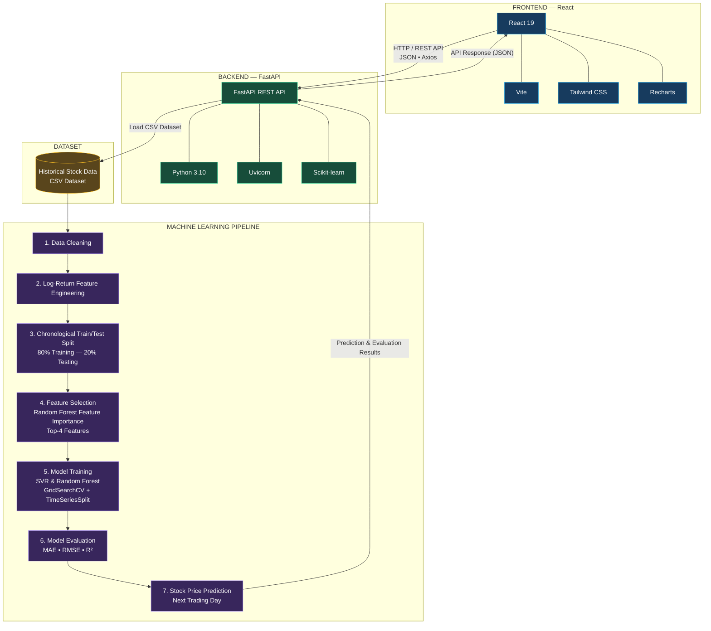

<div align="center">

# 📈 BBRI Stock Forecasting System

**Prediksi harga saham PT Bank Rakyat Indonesia (BBRI) dengan Support Vector Regression & Random Forest — lengkap dengan seleksi fitur otomatis dan dashboard evaluasi interaktif.**


[Fitur](#-fitur-utama) •
[Arsitektur](#-arsitektur-sistem) •
[Pipeline ML](#-machine-learning-pipeline) •
[API](#-api-backend) •
[Cara Menjalankan](#-cara-menjalankan) •
[Roadmap](#-roadmap)

</div>

> [!WARNING]
> **Disclaimer:** Proyek ini dibuat untuk tujuan **edukasi/riset**. Hasil prediksi **bukan** rekomendasi atau nasihat investasi.

---

## 📑 Daftar Isi

- [Fitur Utama](#-fitur-utama)
- [Arsitektur Sistem](#-arsitektur-sistem)
- [Machine Learning Pipeline](#-machine-learning-pipeline)
- [Format Dataset](#-format-dataset)
- [API Backend](#-api-backend)
- [Struktur Proyek](#-struktur-proyek)
- [Tech Stack](#-tech-stack)
- [Cara Menjalankan](#-cara-menjalankan)
- [Keterbatasan yang Diketahui](#-keterbatasan-yang-diketahui)
- [Roadmap](#-roadmap)
- [Penulis](#-penulis)

---

## ✨ Fitur Utama

| | Fitur | Deskripsi |
|:-:|---|---|
| 📂 | **Upload Dataset OHLCV** | Drag-and-drop CSV, dengan parsing metadata otomatis (rentang tanggal, jumlah baris). |
| 🔮 | **Prediksi Hari Berikutnya** | Memprediksi harga penutupan hari perdagangan berikutnya dengan **SVR (kernel RBF)** dan **Random Forest Regressor**. |
| 🎯 | **Seleksi Fitur Otomatis** | Berbasis *Random Forest Feature Importance*, memilih **Top-4** dari 6 fitur yang tersedia. |
| ⚖️ | **Dua Skenario Prediksi** | Bandingkan langsung *All Features* vs *Selected Features (Top-4)* di dashboard. |
| 📊 | **Evaluasi Model** | Metrik **MAE**, **RMSE**, dan **R²** dalam bentuk tabel dan grafik batang. |
| 📉 | **Grafik Interaktif** | Aktual vs prediksi (50 data uji terakhir) menggunakan Recharts. |
| 📥 | **Ekspor Laporan Excel** | File `.xlsx` berisi ringkasan prediksi, metrik evaluasi, ranking fitur, dan data grafik. |

---

## 🏗️ Arsitektur Sistem



---

## 🧠 Machine Learning Pipeline

### 1️⃣ Pra-pemrosesan Data

Dataset OHLCV dibersihkan melalui `preprocess_data`: pembersihan format angka, pengurutan kronologis, serta *forward/backward fill* untuk nilai kosong.

```python
FEATURES = ["Open", "High", "Low", "Close", "Adj Close", "Volume"]
```

**Log Return** dihitung dari harga penutupan sebagai basis target prediksi (bukan sebagai fitur masukan model):

```python
df["Log_Return"] = np.log(df["Close"] / df["Close"].shift(1))
df["Target_Log_Return"] = df["Log_Return"].shift(-1)
```

Model **tidak memprediksi harga secara langsung**, melainkan **log-return hari berikutnya**, yang kemudian dikonversi kembali ke harga:

```python
predicted_close = last_close * exp(predicted_log_return)
```

### 2️⃣ Dataset Training & Testing

Dataset dibagi oleh pengguna menjadi **dua file CSV terpisah**:

| Dataset | Penggunaan |
|---|---|
| **Training** | *Fitting* scaler, seleksi fitur, tuning hyperparameter, dan pelatihan model. |
| **Testing** | Tidak pernah digunakan saat pelatihan; hanya untuk evaluasi dan grafik aktual vs prediksi. |

### 3️⃣ Seleksi Fitur

Menggunakan **Random Forest Feature Importance** untuk meranking 6 fitur, lalu memilih **Top-4** secara default:

```python
select_features(X_train, y_train, top_k=4)
```

Hasil ranking beserta status `selected` / `dropped` ditampilkan di tab **Feature Selection** pada dashboard.

### 4️⃣ Normalisasi

Fitur dinormalisasi dengan **Min-Max Scaling** — `scaler.fit` hanya pada data latih, lalu diterapkan ke data uji (mencegah *data leakage*).

### 5️⃣ Pelatihan Model

Kedua model dioptimasi dengan `GridSearchCV` menggunakan **`TimeSeriesSplit` (5 fold)** — bukan *k-fold* acak — agar validasi tetap menghormati urutan waktu.

<details>
<summary><b>⚙️ Grid parameter Support Vector Regression (kernel RBF)</b></summary>

```python
param_grid = {
    "C": [0.1, 1, 10, 100],
    "epsilon": [0.01, 0.1, 0.2],
    "gamma": ["scale", "auto"],
}
```

</details>

<details>
<summary><b>🌲 Grid parameter Random Forest Regressor</b></summary>

```python
param_grid = {
    "n_estimators": [50, 100],
    "max_depth": [None, 10, 20],
    "min_samples_split": [2, 5],
}
```

</details>

### 6️⃣ Evaluasi

Prediksi log-return dikonversi kembali ke skala harga sebelum dihitung metriknya:

| Metrik | Kepanjangan |
|---|---|
| **MAE** | *Mean Absolute Error* |
| **RMSE** | *Root Mean Squared Error* |
| **R²** | *Coefficient of Determination* |

Metrik dihitung untuk **kedua skenario** (*All Features* & *Selected Features*) dan **kedua model** (SVR & Random Forest) — total 4 kombinasi.

---

## 🗂️ Format Dataset

File CSV harus memiliki kolom berikut:

| Kolom | Keterangan |
|---|---|
| `Date` | Tanggal perdagangan (format `YYYY-MM-DD`) |
| `Open` | Harga pembukaan |
| `High` | Harga tertinggi |
| `Low` | Harga terendah |
| `Close` | Harga penutupan (basis target prediksi) |
| `Adj Close` | Harga penutupan yang disesuaikan |
| `Volume` | Volume perdagangan |

**Contoh:**

```csv
Date,Open,High,Low,Close,Adj Close,Volume
2015-01-05,3450.00,3480.00,3440.00,3470.00,3470.00,125000000
2015-01-06,3475.00,3490.00,3465.00,3485.00,3485.00,130000000
```

> [!NOTE]
> - Data harus terurut kronologis, disarankan minimal **±100 baris**.
> - Nilai OHLCV harus numerik dan tidak boleh kosong (baris dengan `Date` tidak valid dibuang otomatis).

---

## 🔌 API Backend

Dokumentasi interaktif (Swagger UI) tersedia otomatis di **http://localhost:8000/docs**.

| Method | Endpoint | Fungsi |
|:-:|---|---|
| `POST` | `/api/upload` | Unggah & bersihkan dataset training dan testing |
| `POST` | `/api/predict` | Jalankan seluruh pipeline & prediksi hari berikutnya |
| `GET` | `/api/export-excel` | Unduh laporan Excel |

<details>
<summary><b>📤 POST /api/upload</b></summary>

Mengunggah dua dataset CSV, membersihkan data, dan menyiapkannya untuk pipeline prediksi. Kedua field multipart **wajib** dikirim:

```http
POST /api/upload
Content-Type: multipart/form-data

training_file: <CSV training file>
testing_file: <CSV testing file>
```

**Contoh respons:**

```json
{
  "message": "Dataset training dan testing berhasil diunggah dan diproses!",
  "training": {
    "rows": 2000,
    "start_date": "02 Januari 2015",
    "last_date": "30 Desember 2022",
    "features": 6
  },
  "testing": {
    "rows": 500,
    "start_date": "02 Januari 2023",
    "last_date": "30 Desember 2025",
    "features": 6
  }
}
```

</details>

<details>
<summary><b>🔮 POST /api/predict</b></summary>

Menjalankan seluruh pipeline (seleksi fitur, training SVR & Random Forest untuk 2 skenario, evaluasi, dan prediksi hari berikutnya). Hasil disimpan sementara di memori server (`PREDICTION_CACHE`) agar ekspor Excel tidak perlu menghitung ulang.

**Contoh respons:**

```json
{
  "message": "Prediksi 1 Hari Perdagangan Berikutnya Berhasil!",
  "prediction": {
    "base_date": "30 December 2025",
    "prediction_date": "02 Januari 2026",
    "last_actual_close": 3660.0,
    "Selected_Features": { "SVR": 3720.5, "RandomForest": 3695.25 },
    "All_Features": { "SVR": 3710.0, "RandomForest": 3685.75 }
  },
  "feature_selection": { "selected_features": [...], "ranking": [...] },
  "metrics": { "All_Features": {...}, "Selected_Features": {...} },
  "chart_data": { "actual": [...], "svr_selected": [...], "...": "..." }
}
```

</details>

<details>
<summary><b>📥 GET /api/export-excel</b></summary>

Mengunduh laporan `Laporan_Prediksi_Saham_BBRI.xlsx` dengan 3 sheet:

1. **Ringkasan & Evaluasi**
2. **Seleksi Fitur**
3. **Aktual vs Prediksi**

Jika `/api/predict` belum pernah dijalankan, endpoint ini akan menjalankan pipeline terlebih dahulu.

</details>

> [!IMPORTANT]
> **Catatan implementasi saat ini:** tanggal prediksi (`02 Januari 2026`) dan nilai *benchmark* aktual (`3640.0`) pada `compute_prediction_pipeline()` masih *hard-coded* di `backend/main.py`, bukan dihitung dinamis dari data uji. Sesuaikan nilai ini bila digunakan dengan dataset yang berbeda.

---

## 📁 Struktur Proyek

```text
BBRI-stock-forecast/
├── backend/                    # Backend FastAPI aktif (dipakai docker-compose.yml root)
│   ├── data/                   # Penyimpanan sementara dataset yang diunggah
│   ├── main.py                 # Endpoint: /api/upload, /api/predict, /api/export-excel
│   ├── ml_pipeline.py          # Preprocessing, feature selection, training, evaluasi
│   ├── Dockerfile
│   └── requirements.txt
│
├── frontend/                   # Dashboard React (Vite)
│   ├── src/
│   │   ├── App.jsx             # Komponen utama — dashboard 3 tab (single file)
│   │   ├── components/         # Layout.jsx, Sidebar.jsx (scaffold, belum dipakai)
│   │   ├── pages/              # Dashboard, FeatureSelection, ModelEvaluation (scaffold)
│   │   └── context/            # DataContext.jsx (scaffold)
│   ├── Dockerfile
│   └── package.json
│
├── backend-bbri/               # Salinan/versi lama backend, tidak dipakai docker-compose root
├── dokumentasi/                # Catatan pengembangan & panduan (histori proyek)
├── docker-compose.yml          # Saat ini hanya mengorkestrasi service backend
├── START_DEV.bat / START_SEMUA.bat / START_DOCKER.bat / STOP_DOCKER.bat
└── README.md
```

> [!NOTE]
> Folder `frontend/src/pages/`, `components/`, dan `context/` berisi *scaffold* multi-route yang **belum** diimpor oleh `App.jsx`. UI saat ini adalah satu komponen dengan navigasi tab berbasis `useState`, bukan React Router. Folder `backend-bbri/` adalah salinan backend versi sebelumnya dan tidak digunakan oleh `docker-compose.yml` di root.

---

## 🛠️ Tech Stack

| Kategori | Teknologi |
|---|---|
| **Frontend** | React 19, Vite, Tailwind CSS v4, Recharts, Axios, Lucide Icons |
| **Backend** | Python 3.10, FastAPI, Uvicorn |
| **Machine Learning** | Scikit-learn (SVR, Random Forest, GridSearchCV, TimeSeriesSplit) |
| **Data Processing** | Pandas, NumPy |
| **Ekspor Laporan** | openpyxl |
| **DevOps** | Docker, Docker Compose |

---

## 🚀 Cara Menjalankan

### Opsi 1 — Docker (Backend)

```bash
docker-compose up --build
```

Backend aktif di `http://localhost:8000` (dokumentasi API: `http://localhost:8000/docs`).

Menghentikan container:

```bash
docker-compose down
```

> [!NOTE]
> `docker-compose.yml` di root saat ini **hanya** mengorkestrasi container backend. Frontend dijalankan terpisah (lihat Opsi 2), meskipun `frontend/Dockerfile` tersedia untuk build manual:
> ```bash
> docker build -t bbri-frontend ./frontend
> ```

### Opsi 2 — Mode Pengembangan (tanpa Docker)

**Backend:**

```bash
cd backend
python -m venv venv
venv\Scripts\activate      # Windows
# source venv/bin/activate # macOS/Linux
pip install -r requirements.txt
python main.py             # atau: uvicorn main:app --reload --port 8000
```

**Frontend** (terminal baru):

```bash
cd frontend
npm install
npm run dev
```

Dashboard dapat diakses di `http://localhost:5173` (mode `npm run dev`) atau `http://localhost:3000` bila dijalankan via container frontend.

### 🪟 Skrip Bantu (Windows)

| Skrip | Fungsi |
|---|---|
| `INSTALL_DEPENDENCIES.bat` | Instalasi dependensi frontend & backend sekaligus |
| `START_DEV.bat` / `START_SEMUA.bat` | Menjalankan frontend + backend secara lokal |
| `START_DOCKER.bat` | Menjalankan backend via Docker Compose |
| `STOP_DOCKER.bat` | Menghentikan container Docker |

### 🖥️ Alur Penggunaan Dashboard

1. Unggah CSV **Dataset Training** dan **Dataset Testing** pada panel **Upload Dataset**.
2. Klik **Upload Kedua Dataset** dan pastikan kedua file berhasil diproses.
3. Pilih mode **Ya (Seleksi Fitur)** atau **Tidak (Seluruh Fitur)**, lalu klik **RUN PREDICTION**.
4. Lihat hasil prediksi harga hari berikutnya (SVR & Random Forest) beserta grafik *actual vs prediction* di tab **Dashboard**.
5. Buka tab **Feature Selection** untuk melihat ranking fitur (Random Forest Importance).
6. Buka tab **Model Evaluation** untuk membandingkan MAE, RMSE, dan R² keempat kombinasi (SVR/RF × All/Selected Features).
7. Klik **Download Laporan Excel** untuk mengunduh laporan lengkap.

---

## ⚠️ Keterbatasan yang Diketahui

1. Tanggal prediksi dan harga *benchmark* aktual pada respons `/api/predict` masih statis (*hard-coded*) di `backend/main.py`, sehingga hasil paling akurat bila digunakan dengan dataset acuan yang sama seperti saat pengembangan.
2. Prediksi hanya untuk **1 hari perdagangan ke depan**; belum ada opsi horizon multi-hari.
3. Belum ada penyimpanan model (*model persistence*) — setiap pemanggilan `/api/predict` melatih ulang SVR dan Random Forest dari awal.
4. URL API frontend (`http://localhost:8000`) di-*hardcode* di `App.jsx`, belum memakai variabel lingkungan (`.env`).
5. Prediksi berbasis data historis semata; tidak memperhitungkan faktor eksternal (berita, sentimen pasar, kebijakan) dan **bukan** alat pengambilan keputusan investasi yang berdiri sendiri.

---

## 🗺️ Roadmap

- [ ] Validasi silang berbasis waktu yang konsisten di seluruh pipeline
- [ ] Penyimpanan & pemuatan ulang model terlatih (*model persistence*)
- [ ] Prediksi multi-horizon (3, 7 hari, dst.)
- [ ] Konfigurasi API URL melalui environment variable (`VITE_API_BASE_URL`)
- [ ] Rapikan duplikasi `backend-bbri/` dan aktifkan struktur `pages/`/`context/` di frontend (atau hapus bila tidak dipakai)
- [ ] Endpoint *health-check* dan pengujian otomatis (CI)

---

## 👤 Penulis

<div align="center">

**Sapar Hidayat**
Mahasiswa Teknik Informatika — Universitas Maritim Raja Ali Haji (UMRAH)

[](https://github.com/Shdyt13)
[](https://www.linkedin.com/in/sapar-hidayat-s-200684301/)

<sub>Dibangun dengan ❤️ menggunakan Python, FastAPI, React, Scikit-learn, dan Docker.</sub>

</div>
